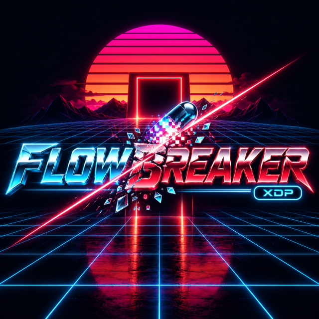
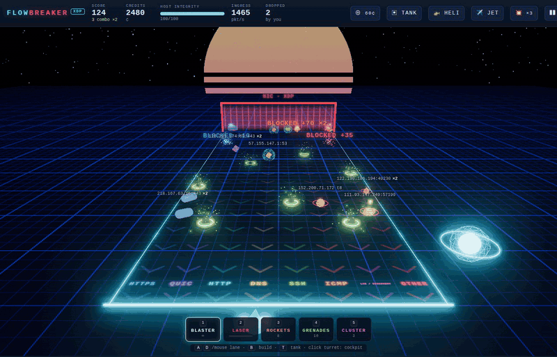
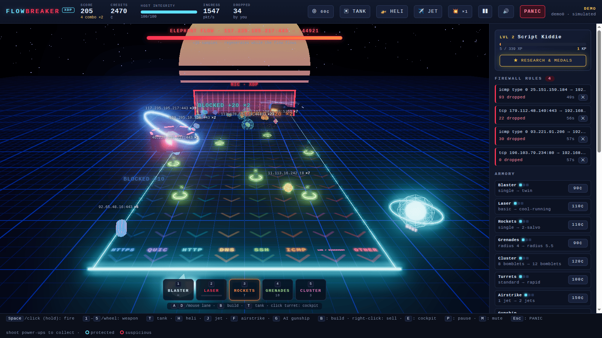
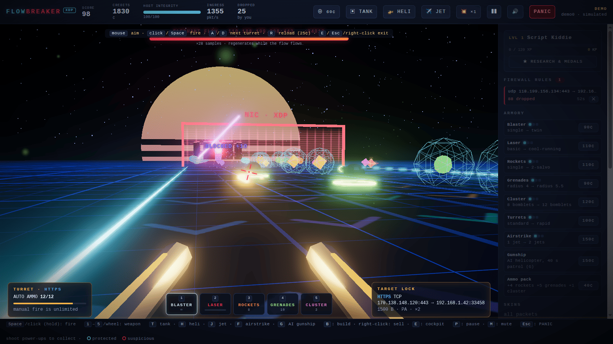
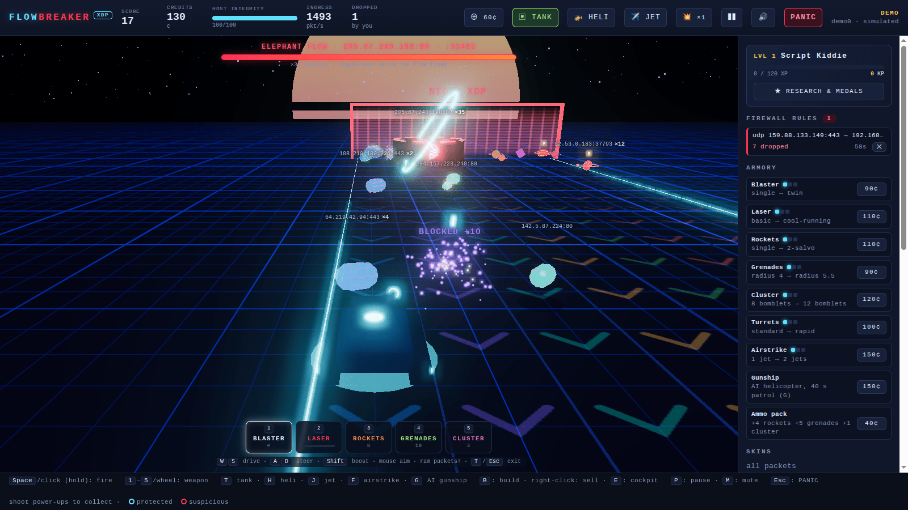
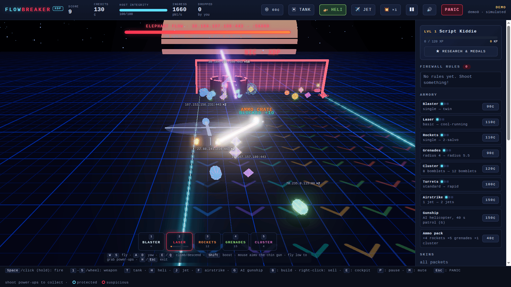
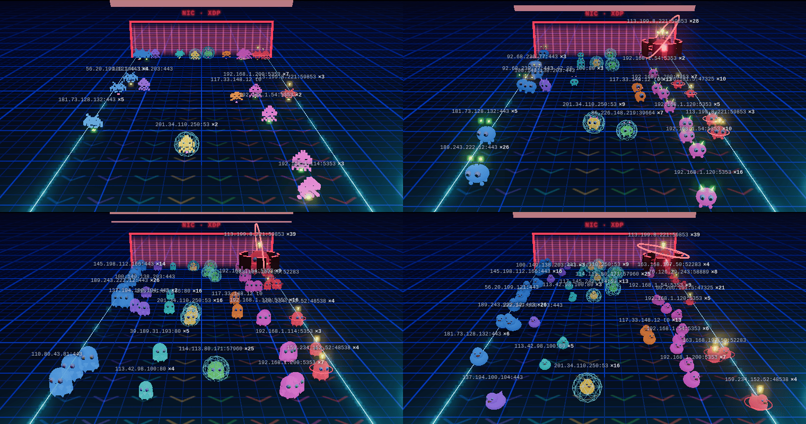
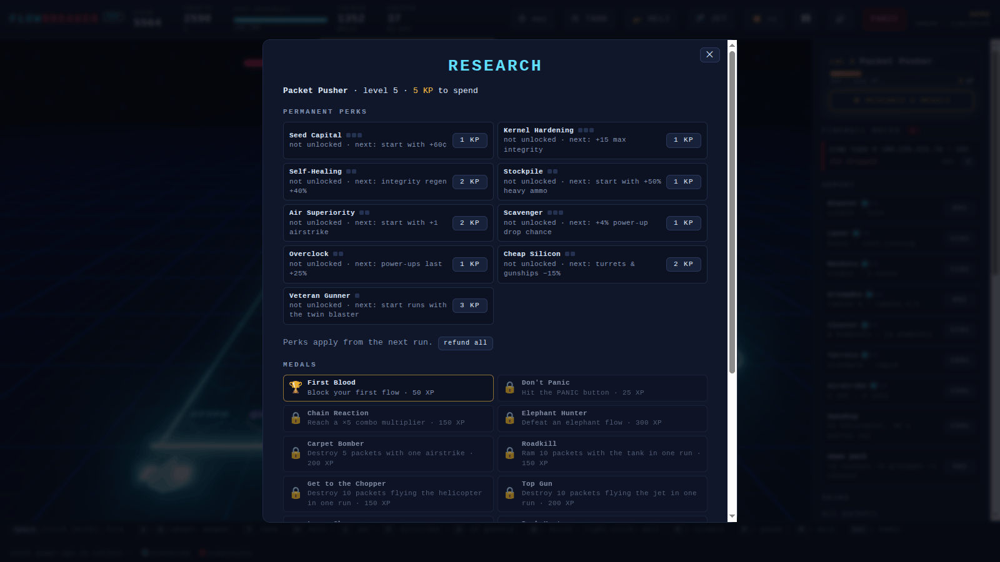
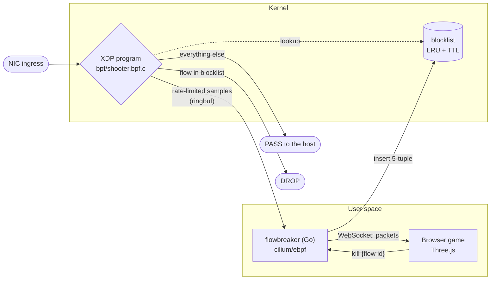

<p align="center">
  
</p>

<p align="center">
  <em>You are the firewall. Real packets from your NIC roll down neon lanes toward your host.<br>Shoot one, and the kernel really drops that flow.</em>
</p>

<p align="center">
  <a href="https://github.com/n1tr0-5urf3r/flowbreaker/actions/workflows/ci.yml"></a>
  
  
  
  
</p>

<div align="center">

This is a toy, not a firewall you should rely on. If it made you grin anyway, feel free to support the development:

<a href="https://www.paypal.com/donate/?hosted_button_id=KXMYX49C6MLLN">
  
</a>

</div>

---

<p align="center">
  
</p>

An eBPF/XDP program watches ingress traffic on a real network interface. A Go daemon
streams a rate-limited sample of it to a Three.js game in your browser, where every
packet rolls down a Tron-style lane from the **NIC·XDP** gate toward your host core.
Hit one and the daemon puts its flow into a kernel blocklist. From then on, XDP
drops every packet of that connection until the block expires.

You see your own machine's traffic: the HTTPS of your browser, QUIC to video sites,
DNS lookups, mDNS chatter from the printer down the hall. You decide what lives.

## Features

- **Eight lanes:** HTTPS, QUIC, HTTP, DNS, SSH, ICMP, LAN/discovery and OTHER. Packets
  are sized by length, tinted per flow, and flagged when they look suspicious (inbound
  SYN to an odd port, ping sweeps, UDP to strange low ports).
- **Real consequences:** a kill is a 5-tuple in a BPF LRU map. The HUD counts the
  packets the kernel drops on your behalf, shown as sparks bouncing off the gate.
- **Five weapons:** an endless blaster, a laser beam that heats up and can overheat,
  lock-on rockets, lobbed grenades with splash damage, and cluster bombs that split
  into bomblets.
- **Power-ups** drop from kills: rapid fire, spread shot, laser overcharge, ammo crate,
  repair, an extra airstrike, credits. Shoot them or drive over them to collect.
- **Armory:** spend credits on three upgrade levels for each weapon, the turrets and the
  airstrike, on ammo packs, or on an AI gunship that patrols for 40 s.
- **Turrets and cockpit:** build turrets that auto-fire down their lane, or climb into
  one and aim it yourself, first person.
- **Elephant flows:** a flow that sends a lot of samples turns into an armoured boss with
  an HP bar. It regenerates while its flow keeps flowing and fires EMP pulses that stun
  turrets and vehicles. Beat it to block the flow, for +500 and a shower of power-ups.
- **Vehicles:** drive a tank and ram packets, or fly a helicopter or a jet. Jets make
  bomb runs with grenades and cluster bombs.
- **Airstrikes:** jets carpet-bomb a lane, and upgrades bring more jets. You earn a
  charge from power-ups and from every 15 blocked flows.
- **Progression:** XP, levels and rank titles from *Script Kiddie* to *XDP Overlord*.
  Each level gives Kernel Points for permanent perks. There are also 13 medals,
  lifetime stats and a summary at the end of each run. All of it is saved in your browser.
- **Packet skins:** Neon shapes, Space Invaders, Critters, Ghosts, Crystals or Rubber
  ducks, globally or per lane, with custom lane colours.
- **Sound:** procedural Web Audio effects and a synthwave soundtrack, no audio files.

## A look around

| | |
|:--:|:--:|
| <a href="docs/screenshot-overview.png"></a> | <a href="docs/screenshot-cockpit.png"></a> |
| **Overview:** turrets, a boss elephant flow, rockets in flight | **Cockpit:** first-person turret with target lock |
| <a href="docs/screenshot-tank.png"></a> | <a href="docs/screenshot-heli.png"></a> |
| **Tank:** chase camera, ram what you can't shoot | **Helicopter:** chin-gun laser, fly low for power-ups |
| <a href="docs/screenshot-skins.png"></a> | <a href="docs/screenshot-research.png"></a> |
| **Skins:** Space Invaders, Critters, Ghosts, Rubber ducks | **Research & medals:** permanent perks for Kernel Points |

<sub>All captures are from demo mode with simulated traffic.</sub>

## How it works



* **Kernel:** `bpf/shooter.bpf.c` parses Ethernet, VLAN, IPv4/IPv6 and TCP/UDP/ICMP
  into a 5-tuple. Flows in the blocklist are dropped and everything else passes. A
  rate-limited sample goes to user space over a ring buffer.
* **Daemon:** `cmd/flowbreaker` loads and attaches the program with cilium/ebpf (bindings
  generated by bpf2go). It streams samples over a local WebSocket and turns kills into
  blocklist entries. The browser only ever sees opaque flow IDs, so a page can block
  only flows the daemon actually saw.
* **Game:** `web/` is plain ES modules with a vendored Three.js r170. No bundler, no
  `node_modules`. It is embedded into the binary.

## Quick start

### Demo mode (no root, no eBPF)

```sh
git clone https://github.com/n1tr0-5urf3r/flowbreaker.git && cd flowbreaker
make demo        # serves web/ with a built-in traffic simulator
```

Open <http://127.0.0.1:8099/?demo=1>. Needs only Python 3 and a browser with WebGL.
Nothing is dropped in demo mode.

### Real mode (your actual NIC)

Requires Linux with BPF and XDP support, clang and Go 1.22+.

```sh
make             # bpf2go generate + go build
make run         # sudo ./flowbreaker -iface <interface of your default route>
# or pick one yourself:  sudo ./flowbreaker -iface wlp1s0 -ttl 30s
```

Open the URL it prints, `http://127.0.0.1:8088/?token=…`, then make some noise:

```sh
scripts/traffic.sh   # pings, curl over HTTPS/HTTP/QUIC, DNS lookups
```

To skip sudo every time, `make setcap` grants `cap_bpf,cap_net_admin,cap_perfmon` to
the binary.

| Flag | Default | Meaning |
|---|---|---|
| `-iface` | (required) | interface to defend |
| `-listen` | `127.0.0.1:8088` | UI address, keep it on loopback |
| `-ttl` | `60s` | how long a shot flow stays blocked (`0` = until exit) |
| `-protect` | SSH, DNS, DHCP, IPv6 ND | never-droppable `proto:port` rules |
| `-protect-hosts` | `api.anthropic.com,claude.ai` | never-droppable remote hosts: hostnames, IPs or CIDRs |
| `-max-eps` | `150` | sampled packets per second sent to the UI |
| `-sample` | `200ms` | minimum gap between two samples of one flow |

## Controls

| Where | Keys |
|---|---|
| Everywhere | **click** / **Space** (hold): fire · **1–5** / **wheel**: pick a weapon |
| | **T**: tank · **H**: helicopter · **J**: jet (same key or **Esc** exits, another key switches) |
| | **F**: airstrike · **G**: buy an AI gunship · **P**: pause · **M**: mute |
| Overview | **mouse** / **A D**: pick a lane · **B**: build a turret · **right-click**: sell |
| | **click a turret** / **E**: climb into its cockpit · **F**, then click a lane: target the airstrike |
| | **Esc**: **PANIC** |
| Cockpit | **mouse**: aim · **A D**: hop to the next turret · **R**: reload · **E** / **Esc** / right-click: climb out |
| Tank | **W S**: drive · **A D**: steer · **Shift**: boost · **mouse**: aim the turret · ram packets |
| Helicopter | **W S**: fly · **A D**: yaw · **E Q**: climb / descend · **Shift**: boost · **mouse**: chin gun |
| Jet | **W S**: throttle · **A D**: bank · **E Q**: climb / dive · **mouse**: aim ahead · grenades / cluster: bomb run |

In a vehicle or the cockpit, **F** strikes the lane you are aiming at. Upgrades, ammo,
the gunship and skins live in the side panel, and so does **★ Research & Medals**.

Suspicious packets that reach the host cost integrity. At zero your host is
"compromised" and the run ends; kernel rules are not affected by game over. A cyan
shield marks a protected packet: shots pass through it.

## Safety rails

Shooting your own SSH session is funny exactly once, so the game is fenced in:

- **Protected ports:** SSH, DNS, DHCP and IPv6 neighbour discovery can never be
  blocked. Both the kernel and the daemon enforce this.
- **Protected hosts:** `api.anthropic.com` and `claude.ai` by default (`-protect-hosts`),
  resolved at start and re-resolved every minute.
- **TTL:** every block expires, after 60 s by default.
- **PANIC:** the button (or Esc in the overview) clears every kernel rule at once. It
  also dismantles your turrets (50 % refund), recalls gunships and cancels airstrikes,
  so nothing blocks the flows again straight away.
- **Dead-man switch:** if no UI heartbeat arrives for 15 s, for example because you
  closed the tab, all rules are cleared.
- **No leftovers:** the XDP link is not pinned. When `flowbreaker` exits or crashes, the
  program detaches.
- **Locked-down UI:** loopback only, random session token, cross-origin WebSockets
  rejected.

Ingress only. Dropping the inbound half is enough to stall a TCP or UDP session. IPv6
extension headers are not walked. On Wi-Fi the program usually runs in generic (SKB)
XDP mode, which is plenty at game rates.

## Development

```sh
make test        # go vet + unit tests (policy parsing, flow ids, WebSocket protocol)
make test-bpf    # as root: verifier load + BPF_PROG_TEST_RUN verdict tests
make generate    # recompile bpf/shooter.bpf.c and regenerate the Go bindings
```

The generated bindings in `internal/bpfobj/` are committed. CI regenerates them and
fails if they differ, so commit the output of `make generate` along with any change
to the C program.
